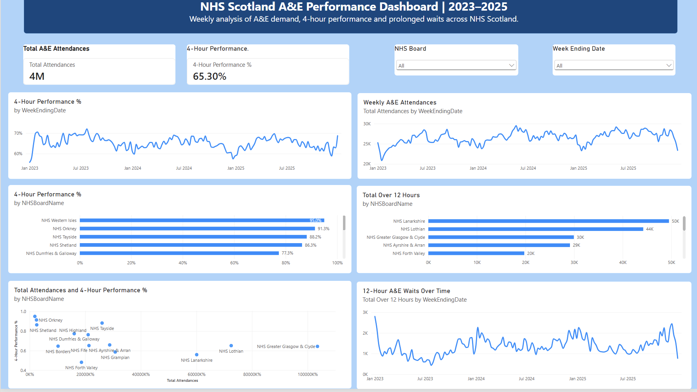

# NHS Scotland A&E Performance Analysis | 2023–2025

**A look at where emergency department waits are longest in Scotland, how they have changed over three years, and whether higher demand explains them.**



---

## Project Overview

In Scotland, the A&E standard is that 95% of patients should be admitted, transferred or discharged within four hours of arriving. In practice, emergency departments have fallen well short of that for several years. Long waits matter beyond the headline figure: a patient who spends more than 12 hours in an emergency department is often waiting for a bed. That makes prolonged waits a useful signal of pressure across the wider hospital, not just in A&E.

I wanted to go beyond the national average and ask a more specific question: is poor performance spread evenly across Scotland, or concentrated in particular boards and hospitals? Using Public Health Scotland's weekly emergency department data, I measured four-hour performance and 12-hour waits across all 14 NHS boards from 2023 to 2025. I then looked more closely at the Royal Infirmary of Edinburgh, Scotland's second-busiest site in the data. Finally, I built an interactive Power BI dashboard so the patterns can be explored by board and by week.

## Business Problem and Objectives

National four-hour performance is widely reported, but a single Scotland-wide percentage hides a lot of variation. A planner or performance manager needs to know *where* waits are persistently long and whether those sites are simply busier than others.

**Main research question**

> Which NHS Scotland emergency departments experience persistent long waiting times, and how does performance change with attendance volumes and seasonal demand?

**Supporting questions**

1. How has four-hour A&E performance changed between 2023 and 2025?
2. Which NHS boards show the strongest and weakest performance?
3. Are there noticeable seasonal patterns in waiting times?
4. How does attendance volume relate to four-hour performance?
5. Which NHS boards have the largest numbers of patients waiting longer than 12 hours?

## Dataset and Data Source

| Item | Detail |
|---|---|
| Source | [Public Health Scotland – Weekly A&E Activity and Waiting Times](https://www.opendata.nhs.scot/dataset/weekly-accident-and-emergency-activity-and-waiting-times) (Open Government Licence) |
| Raw extract | 42,825 rows × 15 columns, week ending 22 Feb 2015 to 13 Sep 2026 |
| Analysis subset | 4,710 rows: week ending 1 Jan 2023 to 28 Dec 2025 (157 weeks) |
| Coverage | 14 NHS boards, 30 emergency departments |

Each row records one emergency department for one week. Key fields include `WeekEndingDate`, `NHSBoardName`, `LocationName`, `AttendanceCategory`, `NumberOfAttendancesEpisode`, `NumberWithin4HoursEpisode`, and the counts and percentages of patients waiting over 4, 8 and 12 hours.

Two points about the data shaped how I prepared it:

- **Each attendance appears in more than one category.** `AttendanceCategory` splits activity into *Unplanned*, *New planned* and *All*, where *All* is the sum of the other two. Summing every row would count the same patients twice, so I kept only the *All* rows.
- **The weekly release covers emergency departments only.** Minor injury units and smaller rural sites are excluded, so these figures are not the official measure of performance against the 95% standard. Public Health Scotland publishes that measure monthly.

## Tools and Technologies

- **Python (Pandas)** for loading, checking, filtering and aggregating the data. I chose to work in a notebook so that each step, from the raw file to the summary tables, could be retraced and rerun.
- **Matplotlib** for exploratory charts while I was still forming questions: yearly trends, board rankings, and the monthly profile of the Royal Infirmary of Edinburgh.
- **Power BI and DAX** to present the results interactively. Three measures (`Total Attendances`, `4-Hour Performance %` and `Total Over 12 Hours`) drive every visual, so the figures update correctly whenever a board or date range is filtered.

## Data Preparation and Methodology

All preparation is in [`notebooks/01_data_cleaning_eda.ipynb`](notebooks/01_data_cleaning_eda.ipynb).

1. **Loading and profiling.** I loaded the raw CSV and checked its shape, data types and date range.
2. **Quality checks.** The extract had no missing values and no duplicate rows. Because the data was already clean, preparation focused on choosing the right subset rather than repairing records.
3. **Transformation.** I converted `WeekEndingDate` to a datetime, filtered to 2023–2025 and kept only the *All* category. I saved the result as `ae_scotland_2023_2025.csv`, which is also the table the Power BI model uses.
4. **KPI calculation.** I calculated four-hour performance as *total seen within four hours ÷ total attendances*, rather than averaging the weekly percentages. This weights each department by its activity, so a small island hospital does not count as much as Glasgow.
5. **Exploratory analysis.** I compared performance by year, ranked the boards, and measured each board's change between 2023 and 2025. I then broke NHS Lothian down by hospital and analysed the Royal Infirmary of Edinburgh by month, including how it compared with Scotland as a whole.
6. **Dashboard build.** I saved the summary tables to `data/processed/` and built the dashboard in Power BI. The 65.30% headline on the dashboard matches the notebook calculation exactly.

## Dashboard Overview

The single-page dashboard is designed to answer "how is Scotland doing, and where are the problems?" at a glance:

- **KPI cards:** total attendances (≈4.16 million) and overall four-hour performance (65.30%).
- **Weekly trend lines:** attendances, four-hour performance and 12-hour waits over time, so seasonal dips and spikes are visible.
- **Board comparisons:** four-hour performance and total 12-hour waits, each ranked by NHS board.
- **Scatter plot:** total attendances against four-hour performance for each board, to show whether larger boards consistently perform worse.
- **Slicers:** NHS board and week-ending date, which filter every visual together.

## Key Findings

**1. Performance stayed far below the 95% standard and barely moved.**
Across the three years, 65.30% of the 4,160,350 attendances were completed within four hours. The yearly figures were 66.27% in 2023, 64.71% in 2024 and 64.95% in 2025. Attendances per week rose from about 25,600 to about 27,000 over the same period. (The 2023 total covers 53 week-endings and the later years 52, so I compared yearly volumes on a per-week basis.)

**2. The gap between boards is very large.**
Board-level performance ranged from 94.96% in NHS Western Isles to 48.14% in NHS Forth Valley. NHS Lanarkshire (55.91%) and NHS Grampian (58.63%) were also well below the national figure. Only NHS Lothian (+6.10 percentage points) and NHS Orkney (+4.57 pp) improved between 2023 and 2025. Grampian fell the most (−6.12 pp).

**3. Twelve-hour waits are concentrated in a handful of boards.**
Scotland recorded 211,891 attendances lasting over 12 hours. NHS Lanarkshire had the most (49,511), followed by Lothian (44,220), Greater Glasgow & Clyde (29,945) and Ayrshire & Arran (29,145). Measured as a share of attendances, the picture changes: Forth Valley (10.6%) and Ayrshire & Arran (10.1%) are highest. Greater Glasgow & Clyde, despite being the busiest board, has a rate of 2.9%, compared with 5.1% nationally.

**4. Volume alone does not explain poor performance.**
On the scatter plot, the small island boards combine low volume with high performance. Among the larger boards, however, the relationship breaks down. Greater Glasgow & Clyde handled over a million attendances at 64.35%, while Lanarkshire handled 601,042 at 55.91%. NHS Tayside (260,621 attendances) achieved 88.16%. This suggests that local factors matter more than size, although the data cannot say which ones.

**5. Winter is the weakest period.**
At the Royal Infirmary of Edinburgh, the five worst months were January, February, November and December 2023 and January 2024, all between 42% and 45%. On the Scotland-wide dashboard, four-hour performance dips and 12-hour waits rise around each new year. Winter pressure is a plausible explanation, but I have not tested seasonality formally.

**6. The Royal Infirmary of Edinburgh closed most of its gap with Scotland.**
The RIE's four-hour performance rose from 48.51% in 2023 to 61.37% in 2025. Over the same period, its gap with the national figure narrowed from −17.76 pp to −3.58 pp. Most of that improvement came in 2025, and it accounts for much of NHS Lothian's improvement. The data shows *that* performance improved, not *why*.

## Business Implications

- **Performance monitoring:** ranking boards on both four-hour performance and 12-hour rates highlights where the two measures disagree, as they do for Greater Glasgow & Clyde.
- **Targeting support:** Forth Valley, Lanarkshire and Grampian combine low performance with flat or falling trends, which makes them obvious candidates for closer review.
- **Seasonal planning:** the winter dips support planning for capacity ahead of the new year rather than reacting once performance has already fallen.
- **Learning from improvement:** sites that improved, such as the RIE in 2025, are worth investigating to find out which operational changes coincided with the improvement.

These are possible uses of the analysis. The project has not been used by any NHS organisation.

## Limitations

- **Descriptive, not causal.** The analysis identifies patterns but cannot explain them. Bed occupancy, staffing, delayed discharges and the mix of patients are not in the dataset.
- **Emergency departments only.** Minor injury units and smaller sites are excluded, so board figures are not the official four-hour standard. Boards with a lot of activity outside their EDs are particularly affected.
- **Boards are not like-for-like.** The island boards each run a single small department, so their percentages rest on far fewer patients than mainland boards.
- **Uneven calendar periods.** Weeks are assigned by their end date: 2023 has 53 week-endings, and its first week mostly falls in December 2022. Monthly totals are also uneven, because some months contain five week-endings and others four.
- **Attendance–performance correlation.** The notebook reports a correlation of 0.433 between monthly attendances and performance at the RIE. However, the busiest months in that series are mostly the ones with five week-endings, so the coefficient largely reflects month length rather than demand. A weekly series would be a fairer test.

## Project Structure

```
nhs-scotland-ae-analysis/
├── README.md
├── data/
│   ├── raw/
│   │   └── weekly_ae_raw.csv
│   └── processed/
│       ├── ae_scotland_2023_2025.csv
│       ├── scotland_yearly_performance.csv
│       ├── nhs_board_yearly_performance.csv
│       ├── nhs_board_performance_change.csv
│       ├── rie_monthly_performance.csv
│       └── rie_yearly_performance.csv
├── notebooks/
│   └── 01_data_cleaning_eda.ipynb
├── dashboards/
│   └── NHS_Scotland_AE_Analysis.pbix
└── images/
    └── dashboard_overview.png
```

## Conclusion and Reflection

The main finding is that Scotland's four-hour performance has stayed around two-thirds for three years, and that the national average hides very different local pictures. A few boards account for most of the longest waits, and size alone does not explain which ones.

Working with official healthcare data taught me to read the data documentation before calculating anything. Without it, I would have double-counted attendances by summing every category, or presented a correlation that mostly reflects how many Sundays fall in each month. Choosing how to aggregate the data (summed counts rather than averaged percentages, per-week rather than per-year totals) turned out to matter as much as the charts.

There are several ways to extend the project. I could repeat the volume analysis on weekly data for every board, test the seasonal pattern formally, and add the monthly all-sites release so the results can be compared with the official standard. Linking in bed-occupancy or delayed-discharge data would also allow the analysis to explore *why* some boards struggle more than others.

## Author

**Nithin Sanjeev**
MSc Artificial Intelligence & Data Science, Edinburgh Napier University, United Kingdom
Interests: Data Analytics, Business Intelligence and Machine Learning
